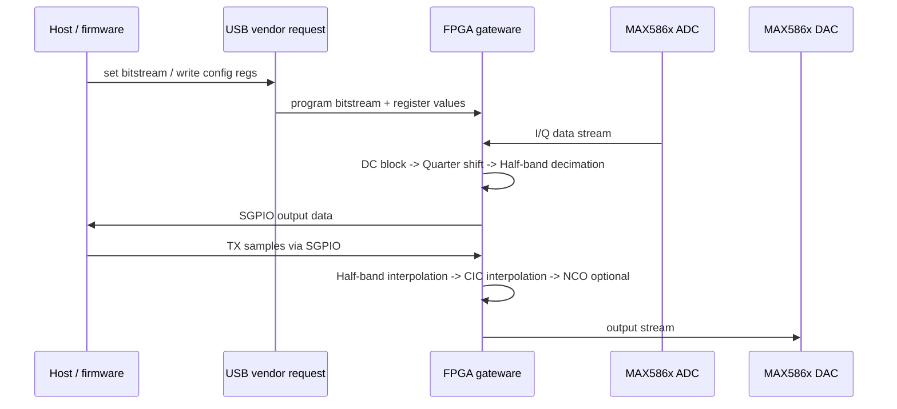

# HackRF FPGA 深度分析：standard gateware 调用链与时序

本文是对 FPGA 设计的一份更深一层的源码导读，主线为：

- `firmware/fpga/top/standard.py`
- `firmware/fpga/board.py`
- `firmware/fpga/interface/*.py`
- `firmware/fpga/dsp/*.py`
- `firmware/common/*.c`

它重点解释这套 FPGA gateware 是如何组织起来的，以及标准 mode 是如何把 ADC、DAC、SGPIO、SPI 和 DSP 链串起来的。

## 1. 总体结论

HackRF 的 FPGA 不是“一段固定逻辑 + 一些寄存器”，而是一套“可配置硬件信号链”。

核心代码位于：

- `firmware/fpga/`
- `firmware/common/`

其中：

- `firmware/fpga/`：硬件描述（Amaranth HDL）
- `firmware/common/`：固件驱动（C）
- `host/libhackrf/`：host 侧控制接口（USB vendor requests）

在这个项目里，FPGA 负责的是大量数字处理任务，而 MCU 侧更多负责管理、配置和数据搬运。

## 2. 代码结构：从总入口到模块分层

### 2.1 顶层入口

最重要的文件：

- `firmware/fpga/top/standard.py`

它定义了 `Top(Elaboratable)`，其中：

- `m.submodules.clkgen = ClockDomainGenerator()`
- `m.submodules.adcdac_intf = MAX586xInterface(...)`
- `m.submodules.mcu_intf = SGPIOInterface(...)`
- `m.submodules.spi_regs = SPIRegisterInterface(...)`
- 组装 `rx_chain` 和 `tx_chain`

这说明标准 gateware 的入口就是“把所有模块写成一个大的协调单元”。

### 2.2 平台定义

- `firmware/fpga/board.py`

这个文件写死了真实板子的 FPGA 平台：

- 设备：`iCE40UP5K`
- 包装：`SG48`
- 时钟：`afe_clk`, `fpga_clk`
- ADC/DAC：`da`, `dd`
- SGPIO：`host_clk`, `host_data`
- 其他控制：`direction`, `disable`, `capture_en`, `q_invert`

也就是说，`board.py` 是“硬件映射层”，它把 FPGA 内部名字映射到板上真实引脚。

### 2.3 接口层

- `firmware/fpga/interface/max586x.py`
- `firmware/fpga/interface/sgpio.py`
- `firmware/fpga/interface/spi.py`

对应三种 I/O：

- ADC/DAC 连接
- SGPIO host 接口
- SPI 配置寄存器接口

### 2.4 DSP 层

- `firmware/fpga/dsp/dc_block.py`
- `firmware/fpga/dsp/quarter_shift.py`
- `firmware/fpga/dsp/fir.py`
- `firmware/fpga/dsp/cic.py`
- `firmware/fpga/dsp/nco.py`
- `firmware/fpga/dsp/*.py`

这层是 FPGA 真正实现 SDR 数字处理的地方：

- DC offset removal
- quarter-rate shift
- half-band decimation / interpolation
- CIC interpolation
- NCO
- 采样格式转换、时钟域转换、FIFO/Skid buffer

## 3. 标准 gateware 的完整调用链图

```mermaid
flowchart TD
    A[firmware/fpga/top/standard.py<br/>Top.elaborate()] --> B[board.py<br/>PralinePlatform]
    A --> C[ClockDomainGenerator]
    A --> D[MAX586xInterface]
    A --> E[SGPIOInterface]
    A --> F[SPIRegisterInterface]

    D --> D1[ADC DDR input<br/>platform.request("da")]
    D --> D2[DAC DDR output<br/>platform.request("dd")]
    D --> D3[q_invert logic]

    E --> E1[host_clk / host_data]
    E --> E2[direction / disable / capture_en]
    E --> E3[trigger_en / prbs]

    F --> F1[register 0x01 ctrl]
    F --> F2[register 0x02 rx_decim]
    F --> F3[register 0x03 rx_pstep]
    F --> F4[register 0x04 tx_ctrl]
    F --> F5[register 0x05 tx_intrp]
    F --> F6[register 0x06 tx_pstep]

    A --> R[rx_chain]
    R --> R1[DCBlock]
    R --> R2[QuarterShift]
    R --> R3[HalfBandDecimator 5-stage]
    R --> R4[ClockConverter]
    R4 --> R5[mcu_intf.adc_stream]

    A --> T[tx_chain]
    T --> T1[ClockConverter]
    T --> T2[HalfBandInterpolator]
    T --> T3[CICInterpolator]
    T --> T4[NCO]
    T4 --> T5[adcdac_intf.dac_stream]

    R5 --> H[SGPIOInterface -> MCU/host]
    H --> M[Host / firmware]
    M --> F

    F --> C1[Write control register values]
    C1 --> R
    C1 --> T
```

这一张图说明了标准模式的主架构：

- RX：ADC -> DSP -> SGPIO -> MCU/host
- TX：MCU/host -> SGPIO -> DSP -> DAC
- 控制信号来自 SPI 寄存器，而不是写死在逻辑里

## 4. standard.py 的代码级分析：真正的硬件主控

`firmware/fpga/top/standard.py` 是最重要的文件。先看它的结构。

### 4.1 入口和时钟域

```python
m.submodules.clkgen = ClockDomainGenerator()
adc_clk = "adclk"
dac_clk = "daclk"
```

这里定义了两个关键时钟域：

- `adclk`: ADC 侧时钟域
- `daclk`: DAC 侧时钟域

`ClockDomainGenerator` 在 `board.py` 里生成并绑定时钟资源：

- `afe_clk` -> `adclk`
- `fpga_clk` -> `daclk`

这个设计很重要，因为 ADC 和 DAC 端口往往运行在不同的时钟域，必须隔离和同步。

### 4.2 顶层子模块实例化

```python
m.submodules.adcdac_intf = adcdac_intf = MAX586xInterface(adc_domain=adc_clk, dac_domain=dac_clk)
m.submodules.mcu_intf    = mcu_intf    = SGPIOInterface(sample_width=16, domain="sync")
```

它实例化了：

- `MAX586xInterface`：ADC/DAC 物理连接
- `SGPIOInterface`：MCU/host 数据接口

之后通过 `platform.request("q_invert").i` 绑定 Q 通道极性控制。

### 4.3 半带滤波器系数

```python
taps = [-2, 0, 7, 0, -18, 0, 41, 0, -92, 0, 320, 512, 320, 0, -92, 0, 41, 0, -18, 0, 7, 0, -2]
```

这是一个 half-band FIR 的系数表，分成多个层级：

- `taps`
- `taps2`
- `taps3`
- `taps4`
- `taps5`

这些是标准模式下的多级抽取/插值滤波器设计，用来实现：

- 低通滤波
- 采样率调整
- 抑制镜像和无用频带

### 4.4 RX 链：从 ADC 到 host

```python
rx_chain = {
    "dc_block": DCBlock(...),
    "quarter_shift": QuarterShift(),
    "hbfir5": HalfBandDecimator(...),
    "hbfir4": HalfBandDecimator(...),
    "hbfir3": HalfBandDecimator(...),
    "hbfir2": HalfBandDecimator(...),
    "hbfir1": HalfBandDecimator(...),
    "clkconv": ClockConverter(...)
}
```

这条链路的语义是：

```text
ADC -> DCBlock -> QuarterShift -> HalfBandDecimator*5 -> ClockConverter -> SGPIOInterface
```

其核心作用：

- 去除 DC 偏置
- 做 fs/4 频移（quarter shift）
- 多级半带抽取降低采样率
- 转到同步域并输出给 host/MCU

### 4.5 TX 链：从 host 到 DAC

```python
tx_chain = {
    "clkconv": ClockConverter(...),
    "hbfir1": HalfBandInterpolator(...),
    "skid2": StreamSkidBuffer(...),
    "hbfir2": HalfBandInterpolator(...),
    "cic_interpolator": CICInterpolator(...),
}
```

语义：

```text
SGPIO -> ClockConverter -> HalfBandInterpolator -> CICInterpolator -> DAC
```

这里体现了：

- 输入样本从 MCU/host 进入
- 先做频率/重采样处理
- 再做 CIC 插值上采样
- 最终输出到 DAC

## 5. `MAX586xInterface`: ADC/DAC 物理接口

文件：`firmware/fpga/interface/max586x.py`

这是 FPGA 与外部 MAX586x 的桥接层。它非常关键，因为它把板级模拟器件连到了 FPGA 数据流上。

### 5.1 ADC 侧

```python
m.submodules.adc_in = adc_in = io.DDRBuffer("i", platform.request("da", dir="-"), i_domain=self._adc_domain)
```

它使用 DDR input buffer 读取 ADC 的双沿数据。这是很典型的 FPGA 与高速 ADC 接口方式：

- `da` 连到了 ADC 的数据线
- DDR 让一个数据线在上/下沿各传一位
- 这样能在同一时钟周期里同时取两份数据

之后：

```python
adc_stream.p.i.eq(adc_in.i[0] ^ 0x80)
adc_stream.p.q.eq(adc_in.i[1] ^ rx_q_mask)
```

这里做了两件事：

- I 通道的极性补偿：`^ 0x80`
- Q 通道的极性/位反转处理：`^ rx_q_mask`

这与板级硬件和信号极性有关。

### 5.2 DAC 侧

```python
m.submodules.dac_out = dac_out = io.DDRBuffer("o", platform.request("dd", dir="-"), o_domain=self._dac_domain)
```

它用 DDR output buffer 把 FPGA 内部样本写到 DAC 数据线上。`dac_stream.valid` 控制是否输出有效样本；否则输出 0x200，保持静态。

这说明：

- FPGA 内部数字信号流通过 DDR 直接驱动外部 DAC
- DAC 输出不是常驻“有样本”，而是按 stream.valid 控制

## 6. `SGPIOInterface`: FPGA 与 MCU/Host 的数据桥

文件：`firmware/fpga/interface/sgpio.py`

这是 HackRF 里非常关键的一层。

它负责：

- 接收 ADC 数据并发给 host/MCU
- 接收 host/MCU 的 TX 数据并发给 FPGA TX 链
- 通过 GPIO/DDR clock/data 完成高速并行接口

### 6.1 数据方向判断

```python
direction_i = platform.request("direction").i
enable_i = ~platform.request("disable").i
transfer_from_adc = (direction == 0)
```

这是典型的双向数据接口：

- `direction == 0`：从 ADC 到 host
- 反之：从 host 到 DAC

### 6.2 时钟和输出

```python
m.submodules.clk_out = clk_out = io.DDRBuffer("o", platform.request("host_clk", dir="-"), o_domain=self._domain)
```

host clock 由 FPGA 产生，作为高速总线时钟。数据线 `host_data` 通过 DDR 模式驱动/采样。

### 6.3 触发和 capture

```python
m.submodules.trigger_gen = trigger_gen = FlowAndTriggerControl(domain=self._domain)
```

`FlowAndTriggerControl` 用于：

- trigger enable
- trigger input latch
- capture gating

它是 FPGA 里“触发采样”的核心逻辑。

### 6.4 FSM 状态机

`SGPIOInterface` 用了一个状态机：

- `IDLE`
- `RX0`, `RX1`, ...
- `TX0`, `TX1`, ...
- `PRBS`

这说明它不是简单 GPIO 映射，而是使用有状态的数据搬运控制器进行高速采样。其行为是：

- 若当前方向是 RX：在 `capture` 允许下，读取 ADC 流并发出到 host
- 若当前方向是 TX：读取 host 数据并送到 DAC 流
- 若 `prbs` 真，则进入 PRBS 生成模式

## 7. `SPIRegisterInterface`: 配置寄存器层

文件：`firmware/fpga/interface/spi.py`

这是 FPGA 的“控制平面”，负责让 host/firmware 动态配置它的行为。

### 7.1 结构

```python
self.interface = SPICommandInterface(port)
self.registers = {}
```

`SPICommandInterface` 是底层 SPI 事务收发器，负责：

- 解析 SPI 命令
- 区分写/读
- 读取命令、地址、数据

### 7.2 寄存器定义

`standard.py` 中：

```python
ctrl     = spi_regs.add_register(0x01, init=0)
rx_decim = spi_regs.add_register(0x02, init=0, size=3)
rx_pstep = spi_regs.add_register(0x03, init=0)
tx_ctrl  = spi_regs.add_register(0x04, init=0, size=1)
tx_intrp = spi_regs.add_register(0x05, init=0, size=3)
tx_pstep = spi_regs.add_register(0x06, init=0)
```

这些寄存器会直接影响：

- `mcu_intf.trigger_en`
- `mcu_intf.prbs`
- `rx_chain["dc_block"].enable`
- `rx_chain["quarter_shift"].enable`
- `rx_chain["quarter_shift"].up`
- `rx_chain["hbfir*"].enable`
- `tx_chain["hbfir*"].enable`
- `tx_chain["cic_interpolator"].factor`
- `nco.en`, `nco.phase`

这个设计让 FPGA 的行为不像刚烧录好的一次性逻辑，而是高层写寄存器即可调整运行状态。

## 8. `DCBlock`: 直流偏置消除

文件：`firmware/fpga/dsp/dc_block.py`

它实现的是一类“leaky integrator”直流去除滤波器：

```python
y[n] = x[n] - avg[n-1]
avg[n] = alpha * y[n] + avg[n-1]
```

这个类非常典型，代码里使用了：

- `self.output.valid` / `self.input.valid`
- `self.input.ready`
- `EnableInserter` + Galois LFSR 生成 dither
- 可选 saturation 和 dithering

它用于削弱 ADC 采样中的固定偏置，保证 RX 路径更稳定。

## 9. `QuarterShift`: fs/4 频移

文件：`firmware/fpga/dsp/quarter_shift.py`

这个模块实现了在 IQ 两路上进行 90° 相位/频率平移逻辑：

```python
swap  = index[0]
inv_q = index[0] ^ index[1]
inv_i = index[1]
```

它是一个四相位状态机：

- 通过 `index` 控制当前频移相位
- `up` 控制方向
- `enable` 控制是否启用该功能

这个模块是 HackRF 能在 RX/TX 中做“有限频移”的关键构件之一。

## 10. `HalfBandDecimator` / `HalfBandInterpolator`: 半带 FIR

文件：`firmware/fpga/dsp/fir.py`

这是最核心的 DSP 模块之一。

### 10.1 作用

- RX：降低采样率，保留低频带有效信息
- TX：提高采样率，实现上采样和插值

### 10.2 关键设计

`HalfBandDecimator` 和 `HalfBandInterpolator` 使用：

- 交错零值/tap 结构
- FIR filter
- `enable` 控制“是否工作”
- `switch_stb` 和 FSM 控制状态切换

这使它们在 FPGA 中能实现非常高效的“half-band”数字滤波。

### 10.3 不同层级

在 `standard.py` 中，使用了多个 decimator/interpolator：

- `hbfir5`, `hbfir4`, `hbfir3`, `hbfir2`, `hbfir1`
- 不同 taps 用于不同衰减和通带特性

就像一条多级滤波链，分段完成采样率转换和带外抑制。

## 11. `CICInterpolator`: CIC 插值

文件：`firmware/fpga/dsp/cic.py`

CIC 是非常适合 FPGA 实现的数字滤波器，尤其在采样率变化很大时效率很高。

`CICInterpolator(1, 3, (1, 2, 4, 8), 8, 8, ...)` 中：

- `M=1`：采样间隔固定
- `stages=3`：3 级 CIC
- `rates=(1, 2, 4, 8)`：支持可变速率因子

它的控制接口：

```python
tx_chain["cic_interpolator"].factor
```

这表示 TX 侧的插值因子是可配置的。

## 12. `NCO`: 数字振荡器

在 `standard.py` 中：

```python
m.submodules.nco = nco = DomainRenamer(dac_clk)(NCO(phase_width=16, output_width=8))
```

NCO 是 TX 路径中可选的本地产生信号源。

- `nco.en`: 启用
- `nco.phase`: 相位累加
- `tx_pstep_dacclk`: 相位步进

这使 FPGA 可以在不依赖于 host 数据输入时，直接生成一个内部测试/参考信号。

## 13. `ClockConverter` 与时钟域同步

文件：`firmware/fpga/util/__init__.py`

`ClockConverter` 是跨时钟域桥接的关键：

```python
fifo.AsyncFIFOBuffered(..., r_domain=output_domain, w_domain=input_domain)
```

它在这些地方被使用：

- RX 侧：`adc_clk -> sync`
- TX 侧：`sync -> dac_clk`

这非常关键，因为 `SGPIOInterface` 和 `MAX586xInterface` 的时钟域并不总是相同的，必须通过异步 FIFO 进行过渡。

## 14. bitstream 构建流程：`build.py`

文件：`firmware/fpga/build.py`

这里是 FPGA 设计的编译入口：

```python
fpga_images = {
    "0_standard": standard(),
    "1_halfprec": half_precision(),
    "2_extprec_rx": ext_precision_rx(),
    "3_extprec_tx": ext_precision_tx(),
}
```

然后：

```python
PralinePlatform().build(image, name=name)
```

生成 bitstream：

- standard
- halfprec
- extprec_rx
- extprec_tx

接着它会用 LZ4 block 压缩打包，输出：

- `build/praline_fpga.bin`

这个文件不是直接给 host 调用的，而是后续由固件加载到 FPGA 中。

## 15. 运行时加载：固件侧是怎么烧 FPGA 的

### 15.1 `firmware/common/fpga_image.c`

这个文件负责：

- 从 flash/loader 中读取 bitstream
- 解析 offset 表
- 按块读取
- LZ4 解压
- 调用 `ice40_spi_syscfg_program()` 下载到 FPGA

它的核心调用：

```c
const bool success = ice40_spi_syscfg_program(
    &ice40,
    loader->out_buffer,
    fpga_image_read_block_cb,
    &fpga_image_ctx);
```

这说明：

- bitstream 是“块式读取 + 解压 + 编程”
- 这不是静态编译好的逻辑，而是动态下载到 FPGA 的

### 15.2 `firmware/common/fpga.c`

这里定义了：

- `fpga_set_trigger_enable()`
- `fpga_set_rx_dc_block_enable()`
- `fpga_set_rx_decimation_ratio()`
- `fpga_set_tx_interpolation_ratio()`
- `fpga_set_tx_nco_enable()`

它本质上是 FPGA 寄存器驱动层：

- 读取寄存器
- 写入寄存器
- 提交 dirty bits

因此，固件和 host 层通过寄存器配置 FPGA 的运行状态。

## 16. host 层控制入口

- `host/libhackrf/src/hackrf.c`

这里定义了：

- `HACKRF_VENDOR_REQUEST_FPGA_WRITE_REG`
- `HACKRF_VENDOR_REQUEST_FPGA_READ_REG`
- `HACKRF_VENDOR_REQUEST_SET_FPGA_BITSTREAM`

它说明 host 层可以：

- 读 FPGA 寄存器
- 写 FPGA 寄存器
- 切换 bitstream

这就是上层应用控制 FPGA 的入口。

## 17. 标准 gateware 的最终时序概况



这张时序图就是标准没啥门槛理解：

- RX：模拟采样 -> FPGA 处理 -> host 接收
- TX：host 发送 -> FPGA 处理 -> 模拟输出

## 18. 适合阅读顺序（最实用）

按最容易理解的顺序建议读：

1. `docs/source/gateware.rst`
2. `firmware/fpga/board.py`
3. `firmware/fpga/top/standard.py`
4. `firmware/fpga/interface/max586x.py`
5. `firmware/fpga/interface/sgpio.py`
6. `firmware/fpga/interface/spi.py`
7. `firmware/fpga/dsp/dc_block.py`
8. `firmware/fpga/dsp/fir.py`
9. `firmware/fpga/dsp/cic.py`
10. `firmware/fpga/build.py`
11. `firmware/common/fpga_image.c`
12. `firmware/common/fpga.c`

这样能：

- 先看到硬件平面
- 再看到数据处理链
- 再看到配置/编程链
- 最后看到上层控制入口

## 19. 一句话总结

HackRF 的 FPGA 是一套“Amaranth 描述的分层 gateware”：

- `board.py` 负责映射引脚
- `top/standard.py` 负责组装 RX/TX 数据链
- `interface/*.py` 负责 ADC/DAC/SGPIO/SPI 接口
- `dsp/*.py` 负责滤波、移频、插值/抽取和 NCO
- `build.py` 负责生成 bitstream
- `firmware/common/*.c` 负责把 bitstream 和配置写入 iCE40 FPGA

因此，HackRF 的 FPGA 实现本质上是一种“可配置 SDR 数字前端 + 抽取/插值 DSP + host/MCU 控制平面”的完整设计。
