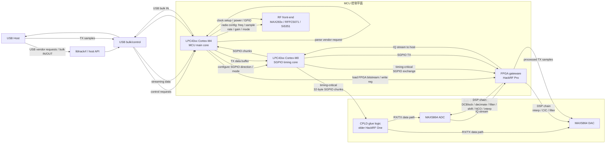
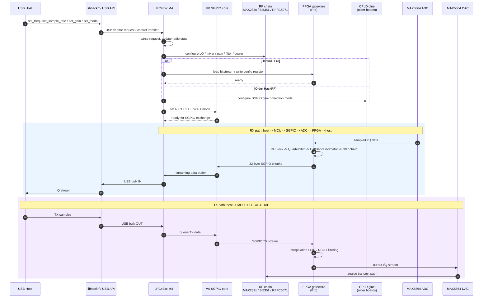

# HackRF MCU 与 FPGA 分工与时序链路分析

本文整理 HackRF 中 MCU（LPC43xx ARM Cortex-M4/M0）和 FPGA 的职责边界，并给出两张关键图：

1. MCU 与 FPGA 的详细分工图
2. 从 USB Host 命令到 RF / ADC / DAC 的时序链路图

## 1. 总体结论

HackRF 不是单一“CPU 直接控制 RF 前端”的结构，而是分层架构：

- MCU：控制平面，负责配置、协调和接口
- FPGA：数字处理平面，负责高带宽 DSP 和采样链
- RF 前端：模拟部分，负责射频收发
- ADC/DAC：模数/数模转换器，连接模拟前端与数字处理链

对于 HackRF One 这类老平台：

- 主控是 MCU
- 中间有 CPLD 作为 glue logic

对于 HackRF Pro：

- 主控仍然是 MCU
- FPGA 取代了原来 CPLD 的部分功能，承担更强的 DSP 能力

## 2. MCU 与 FPGA 的详细分工图



### 2.1 MCU 负责什么

根据 `firmware/hackrf_usb/hackrf_usb.c` 和 `firmware/common/radio.c` 可以看出，MCU 负责：

- USB 协议和 host 控制
- 收发机模式切换（OFF / RX / TX / sweep）
- 频率、采样率、增益、滤波器带宽控制
- 时钟和电源管理
- 控制 RF 前端器件
- 配置 SGPIO
- 在 Pro 上加载 FPGA bitstream 和写入寄存器

### 2.2 FPGA 负责什么

根据 `firmware/fpga/` 中的 gateware 代码，FPGA 负责：

- ADC/DAC 接口层（`interface/max586x.py`）
- SGPIO 接口层（`interface/sgpio.py`）
- SPI 配置接口（`interface/spi.py`）
- DSP 链：
  - `DCBlock`
  - `QuarterShift`
  - `HalfBandDecimator`
  - `HalfBandInterpolator`
  - `CICInterpolator`
  - `NCO`

换句话说：

- MCU 负责“怎么控制”
- FPGA 负责“怎么实时处理数据”

## 3. 从 USB Host 命令到 RF / ADC / DAC 的时序链路图



## 4. 这两条链路的关键理解

### 4.1 RX 链路

```text
Host -> USB -> MCU -> SGPIO -> ADC -> FPGA DSP -> host
```

工作流程：

1. host 发送设置命令
2. MCU 设置 RF/调谐器/增益/采样率
3. MCU / M0 启动 SGPIO 交换
4. ADC 采样得到 I/Q
5. FPGA 对数据做 DC 去除、下采样、滤波、频移等处理
6. 处理结果通过 SGPIO/M0/M4 回传到 USB host

### 4.2 TX 链路

```text
Host -> USB -> MCU -> FPGA DSP -> DAC -> RF front-end -> antenna
```

工作流程：

1. host 发送 TX I/Q samples
2. MCU 把数据放入 M4/M0 buffer
3. FPGA 接收数据并进行插值、CIC、滤波和 NCO 处理
4. DAC 输出模拟波形
5. RF 前端进行上变频和发射

## 5. 实际代码对应关系

- MCU 控制入口：`firmware/hackrf_usb/hackrf_usb.c`
- MCU RF 状态机：`firmware/common/radio.c`
- SGPIO 数据搬运：`firmware/common/sgpio.c`
- M0 timing-critical 代码：`firmware/hackrf_usb/sgpio_m0.s`
- FPGA gateware：`firmware/fpga/top/standard.py`
- FPGA 接口层：`firmware/fpga/interface/*.py`
- FPGA DSP 层：`firmware/fpga/dsp/*.py`

## 6. 一句话总结

MCU 负责“系统控制和数据搬运协调”，FPGA 负责“实时数字处理”，两者配合完成 HackRF 的 SDR 工作流：

- host 下发参数/样本
- MCU 解析并配置 RF 链
- M0 / SGPIO 负责高速 I/O
- FPGA 完成 DSP
- ADC/DAC 把模拟和数字之间连接起来

这就是 HackRF 的硬件分工核心。
