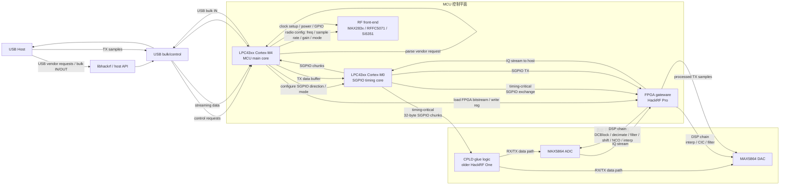
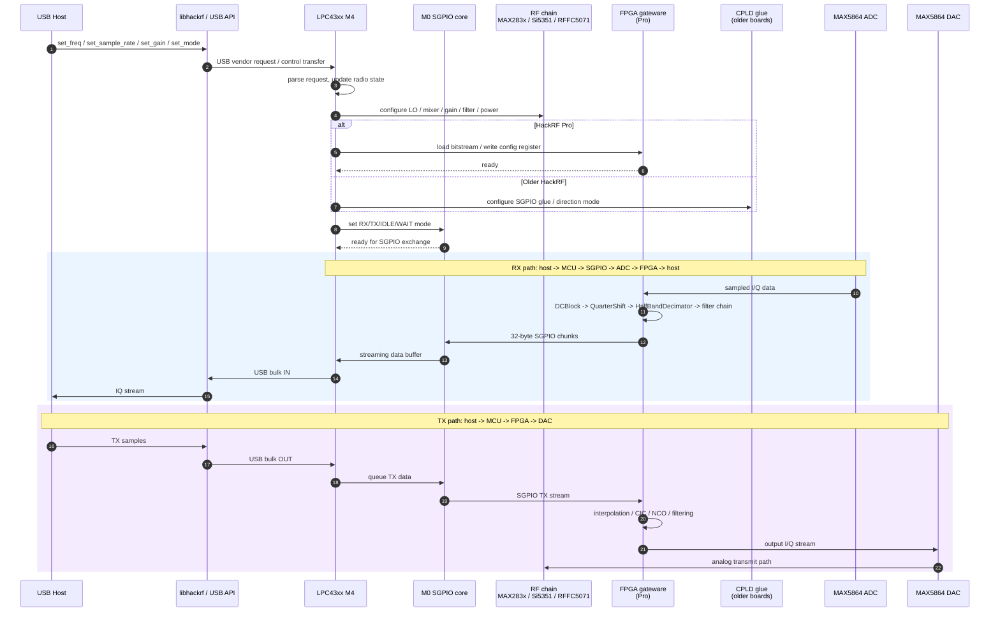
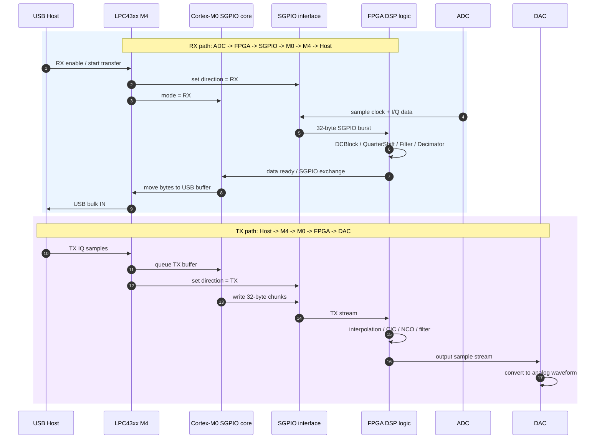

# HackRF MCU 与 FPGA 分工与时序链路分析

本文整理 HackRF 中 MCU（LPC43xx ARM Cortex-M4/M0）和 FPGA 的职责边界，并给出两张关键图：

1. MCU 与 FPGA 的详细分工图
2. 从 USB Host 命令到 RF / ADC / DAC 的时序链路图

## 1. 总体结论

HackRF 不是单一“CPU 直接控制 RF 前端”的结构，而是分层架构：

- MCU：控制平面，负责配置、协调和接口
- FPGA：数字处理平面，负责高带宽 DSP 和采样链
- RF 前端：模拟部分，负责射频收发
- ADC/DAC：模数/数模转换器，连接模拟前端与数字处理链

对于 HackRF One 这类老平台：

- 主控是 MCU
- 中间有 CPLD 作为 glue logic

对于 HackRF Pro：

- 主控仍然是 MCU
- FPGA 取代了原来 CPLD 的部分功能，承担更强的 DSP 能力

## 2. MCU 与 FPGA 的详细分工图



### 2.1 MCU 负责什么

根据 `firmware/hackrf_usb/hackrf_usb.c` 和 `firmware/common/radio.c` 可以看出，MCU 负责：

- USB 协议和 host 控制
- 收发机模式切换（OFF / RX / TX / sweep）
- 频率、采样率、增益、滤波器带宽控制
- 时钟和电源管理
- 控制 RF 前端器件
- 配置 SGPIO
- 在 Pro 上加载 FPGA bitstream 和写入寄存器

### 2.2 FPGA 负责什么

根据 `firmware/fpga/` 中的 gateware 代码，FPGA 负责：

- ADC/DAC 接口层（`interface/max586x.py`）
- SGPIO 接口层（`interface/sgpio.py`）
- SPI 配置接口（`interface/spi.py`）
- DSP 链：
  - `DCBlock`
  - `QuarterShift`
  - `HalfBandDecimator`
  - `HalfBandInterpolator`
  - `CICInterpolator`
  - `NCO`

换句话说：

- MCU 负责“怎么控制”
- FPGA 负责“怎么实时处理数据”

## 3. 从 USB Host 命令到 RF / ADC / DAC 的时序链路图



## 4. 这两条链路的关键理解

### 4.1 RX 链路

```text
Host -> USB -> MCU -> SGPIO -> ADC -> FPGA DSP -> host
```

工作流程：

1. host 发送设置命令
2. MCU 设置 RF/调谐器/增益/采样率
3. MCU / M0 启动 SGPIO 交换
4. ADC 采样得到 I/Q
5. FPGA 对数据做 DC 去除、下采样、滤波、频移等处理
6. 处理结果通过 SGPIO/M0/M4 回传到 USB host

### 4.2 TX 链路

```text
Host -> USB -> MCU -> FPGA DSP -> DAC -> RF front-end -> antenna
```

工作流程：

1. host 发送 TX I/Q samples
2. MCU 把数据放入 M4/M0 buffer
3. FPGA 接收数据并进行插值、CIC、滤波和 NCO 处理
4. DAC 输出模拟波形
5. RF 前端进行上变频和发射

## 5. MCU 如何控制 FPGA 读 ADC / 写 DAC

这一节是前面架构图的技术细化：

- MCU 不是直接写 ADC 或直接读 DAC
- 它控制的是 SGPIO “方向 + 时序 + buffer”
- 真正的 ADC/DAC 高速访问，是由 SGPIO + FPGA 的数据接口完成的

### 5.1 SGPIO 是关键总线

在 `firmware/common/sgpio.c` 中，注释直接说明了硬件分配：

- `SGPIO0..7` = ADC/DAC 数据位
- `SGPIO8` = clock input
- `SGPIO9` = capture input
- `SGPIO10` = disable codec data stream
- `SGPIO11` = direction output

关键代码片段：

```c
// SGPIO0 to 7 = DAC/ADC data bits 0 to 7
// SGPIO8 Clock Input (External Clock)
// SGPIO9 Capture Input (Capture/ChipSelect, 1=Enable Capture, 0=Disable capture)
// SGPIO10 Disable Output (1/High=Disable codec data stream, 0/Low=Enable codec data stream)
// SGPIO11 Direction Output (1/High=TX mode LPC43xx=>CPLD=>DAC, 0/Low=RX mode LPC43xx<=CPLD<=ADC)
```

这表示：

- RX 时，MCU 让 SGPIO 进入 “ADC -> FPGA/MCU” 方向
- TX 时，MCU 让 SGPIO 进入 “MCU/FPGA -> DAC” 方向

### 5.2 RX：从 ADC 读取到 FPGA / MCU

在 `sgpio_configure()` 里，代码会写：

```c
const uint_fast8_t cpld_direction = (direction == SGPIO_DIRECTION_TX) ? 1 : 0;
SGPIO_GPIO_OUTREG =
      (cpld_direction << 11)
    | (1L << 10);
```

这里的方向输出是：

- `cpld_direction = 0` → RX 模式
- `cpld_direction = 1` → TX 模式

在 RX 模式下：

1. ADC 采样数据从模拟前端流入 ADC
2. ADC 用 SGPIO 时钟和数据线把样本发给 FPGA
3. FPGA 的 `SGPIOInterface` 接收样本，并按配置把它送进 DSP 链
4. DSP 链完成 DC blocker / decimation / filter 等处理
5. 处理后的数据通过 SGPIO 通道再交给 M0/M4
6. M4 最终通过 USB bulk IN 发给 host

对应 FPGA 代码：

- `firmware/fpga/interface/sgpio.py`
- `firmware/fpga/top/standard.py`

其中：

```python
transfer_from_adc = (direction == 0)
```

说明 FPGA 在 RX 路径上是被配置为“接收 ADC 数据并输出到 MCU/host”的。

### 5.3 TX：从 FPGA / MCU 写入 DAC

TX 路径的方向相反：

- USB host 发 TX IQ samples
- MCU 把数据放进共享 buffer
- M0 在 SGPIO TX 模式下，把 buffer 中的数据写到 SGPIO shadow registers
- FPGA 接收到这些数据后，进入 TX chain：
  - interpolation
  - CIC
  - filtering
  - NCO
- 最终 FPGA 把处理后的样本送到 DAC

在 `firmware/fpga/top/standard.py` 中，TX 链是：

```python
last = mcu_intf.dac_stream
for block in tx_chain.values():
    connect(m, last, block.input)
    last = block.output

connect(m, last, adcdac_intf.dac_stream)
```

所以 MCU 并不直接把数据 “写到 DAC”，而是把样本送入 FPGA，后者再按 DSP chain 输出到 DAC。

### 5.4 M0 是真正的 SGPIO 时序核心

`firmware/hackrf_usb/sgpio_m0.s` 中明确定义了五个模式：

- `IDLE`
- `WAIT`
- `RX`
- `TX_START`
- `TX_RUN`

它的注释说明得很明确：

> The M0 reads or writes 32 bytes at a time from the SGPIO registers, transferring these bytes to or from a shared USB bulk buffer.

也就是：

- M0 每次处理 32 bytes
- 对 RX：从 SGPIO shadow register 读取 ADC 数据，写入 buffer
- 对 TX：从 buffer 读取样本，写入 SGPIO register，供 FPGA/DAC 使用

这意味着：

- MCU 不是高带宽 DSP 引擎
- MCU 负责“控制 SGPIO burst 传输”和“与 host 交换 buffer”
- FPGA 才是实时处理数据的核心

### 5.5 细化时序图：SGPIO 读写 ADC/DAC



### 5.6 关键理解

真正的高速硬件链路是：

- RX：ADC → FPGA DSP → SGPIO → M0 → M4 → USB host
- TX：USB host → M4 → M0 → SGPIO → FPGA DSP → DAC

所以 MCU 的作用不是直接“取/存 ADC/DAC”，而是：

1. 设置 SGPIO 的模式（RX/TX）
2. 让 M0 巧妙处理 32-byte burst 时序
3. 让 FPGA 接管 DSP 和数据格式转换
4. 最后一层再和 USB host 交换包

## 6. 代码逐函数解读版

下面按“函数调用链”展开，直接对应到源码的真实执行路径。

### 6.1 启动入口：`main()`

位置：`firmware/hackrf_usb/hackrf_usb.c`

`main()` 做的第一件事是：

1. 复制 M0 程序到 RAM
2. 检测硬件平台
3. 初始化 GPIO / 电源 / 时钟 / RF 路径
4. 唤醒 M0
5. 对 HackRF Pro 执行 FPGA bitstream 下载
6. 初始化 `radio` 和 USB

关键代码：

```c
ipc_halt_m0();
ipc_start_m0((uint32_t) &__ram_m0_start__);

#ifdef IS_PRALINE
if (IS_PRALINE) {
    fpga_image_load(&fpga_loader, 0);
}
#endif

radio_init(&radio);
```

这里要注意：

- M0 是 timing-critical 的 SGPIO 执行器
- M4 是更高层的控制器
- `fpga_image_load()` 是 boot 阶段中最核心的 FPGA 配置动作

### 6.2 FPGA 配置入口：`fpga_image_load()`

位置：`firmware/common/fpga_image.c`

函数职责：

- 读取 bitstream header
- 计算当前 bitstream 的偏移地址
- 逐块读取压缩后的 FPGA image
- 通过 callback 把数据交给 SPI 配置程序

关键逻辑：

```c
uint32_t num_bitstreams, bitstream_offset;
loader->read(addr, 4, (uint8_t*) &num_bitstreams);
loader->read(addr + 4 * (index + 1), 4, (uint8_t*) &bitstream_offset);

const bool success = ice40_spi_syscfg_program(
    &ice40,
    loader->out_buffer,
    fpga_image_read_block_cb,
    &fpga_image_ctx);
```

这里的关键理解是：

- 它不是直接把内存“复制进 FPGA”
- 它是把位流文件送到 FPGA 的配置接口
- 这一步完成后，FPGA 才具备“运行的硬件逻辑”

### 6.3 位流下载器：`ice40_spi_syscfg_program()`

位置：`firmware/common/ice40_spi.c`

这是 FPGA 配置的真正实现函数：

```c
gpio_clear(drv->gpio_creset);
delay_us(1800);
gpio_set(drv->gpio_creset);

gpio_set(drv->gpio_select);
spi_ssp1_transfer_word(0);

gpio_clear(drv->gpio_select);
for (;;) {
    size_t read_sz = read_block_cb(read_ctx);
    if (read_sz == 0)
        break;
    for (size_t j = 0; j < read_sz; j++) {
        spi_ssp1_transfer_word(buf[j]);
    }
}

gpio_set(drv->gpio_select);
return gpio_read(drv->gpio_cdone);
```

它做了几件事：

1. 拉低 `CRESET_B`，强制 FPGA 进入配置态
2. 延时以清空内部配置状态
3. 用 SPI 把 bitstream 串行发送给 FPGA
4. 发送完毕后等待 `CDONE` 变高

这里只是“烧录硬件”，不是运行时寄存器控制。

### 6.4 SGPIO 方向控制：`sgpio_configure()`

位置：`firmware/common/sgpio.c`

这个函数负责把 SGPIO 方向切到 RX/TX：

```c
const uint_fast8_t cpld_direction = (direction == SGPIO_DIRECTION_TX) ? 1 : 0;
SGPIO_GPIO_OUTREG =
      (cpld_direction << 11)
    | (1L << 10);
```

关键解释：

- `SGPIO11` 决定方向：
  - TX = 1
  - RX = 0
- `SGPIO10` 控制 codec data stream 使能/禁止
- `SGPIO8`/`SGPIO9` 负责时钟和捕获
- `SGPIO0..7` 承担数据位

这一步本质上是：

- MCU 控制 SGPIO 总线 “流向哪里”
- FPGA 和 ADC/DAC 只能在这个方向下工作

### 6.5 FPGA runtime register：`fpga_reg_write()` / `fpga_reg_read()`

位置：`firmware/common/fpga.c`

运行时控制不是用 RAM，而是通过寄存器接口：

```c
uint8_t fpga_reg_read(fpga_driver_t* const drv, uint8_t r)
{
    uint8_t v;
    v = ice40_spi_read(drv->bus, r);
    drv->regs[r] = v;
    return v;
}

void fpga_reg_write(fpga_driver_t* const drv, uint8_t r, uint8_t v)
{
    drv->regs[r] = v;
    ice40_spi_write(drv->bus, r, v);
    FPGA_REG_SET_CLEAN(drv, r);
}
```

这说明：

- MCU 访问 FPGA 的方式是寄存器写入，不是直接访问 FPGA 内部 RAM
- 软件调用 `fpga_set_rx_dc_block_enable()`、`fpga_set_rx_decimation_ratio()` 等函数，最终都落到 `fpga_reg_write()`

例如：

```c
void fpga_set_rx_decimation_ratio(fpga_driver_t* const drv, const uint8_t value)
{
    set_FPGA_STANDARD_RX_DECIM(drv, value & 0b111);
    fpga_regs_commit(drv);
}
```

这实际上是在改 FPGA DSP 配置寄存器。

### 6.6 FPGA top-level：`Top.elaborate()`

位置：`firmware/fpga/top/standard.py`

这个函数是 FPGA gateware 的中心：

1. 创建 ADC/DAC 接口 (`MAX586xInterface`)
2. 创建 MCU 接口 (`SGPIOInterface`)
3. 组装 RX chain
4. 组装 TX chain
5. 绑定 SPI register interface
6. 把寄存器映射到 DSP 控制信号

最关键的是：

```python
m.submodules.adcdac_intf = adcdac_intf = MAX586xInterface(adc_domain=adc_clk, dac_domain=dac_clk)
m.submodules.mcu_intf    = mcu_intf    = SGPIOInterface(sample_width=16, domain="sync")
```

然后：

```python
connect(m, last, mcu_intf.adc_stream)
```

和：

```python
last = mcu_intf.dac_stream
for block in tx_chain.values():
    connect(m, last, block.input)
    last = block.output
connect(m, last, adcdac_intf.dac_stream)
```

这两段代表：

- RX: ADC → FPGA 内部 chain → SGPIO / MCU
- TX: MCU / SGPIO → FPGA internal chain → DAC

### 6.7 SGPIO FPGA 接口：`SGPIOInterface.elaborate()`

位置：`firmware/fpga/interface/sgpio.py`

这是 FPGA 侧真正跟 MCU 交互的实现：

- 配置方向 `direction_i`
- 如果方向为 RX，则允许 ADC 采样流进 FPGA
- 如果方向为 TX，则允许 FPGA 数据流进 DAC
- 处理 `tx_fifo` 和 capture trigger

关键逻辑：

```python
direction_i = platform.request("direction").i
transfer_from_adc = (direction == 0)
```

和：

```python
with m.FSM():
    with m.State("IDLE"):
        with m.If(transfer_from_adc):
            if adc_stream.valid & capture:
                m.next = "RX0"
        with m.Else():
            with m.If(dac_stream.ready & capture):
                m.next = "TX0"
```

这说明 FPGA 侧本质上是一个时序状态机：

- RX 状态：接收 ADC，送给 host
- TX 状态：接收 host，送给 DAC

### 6.8 M0 SGPIO timing loop：`sgpio_m0.s`

位置：`firmware/hackrf_usb/sgpio_m0.s`

M0 是不走常规函数调用的底层定时实现，代码注释写得很明确：

- 运行在 Cortex-M0
- 处理物理层时序要求高的 SGPIO exchange
- 每次处理 32 bytes
- 读取/写入 SGPIO shadow registers
- 处理 RX 和 TX shortfall/overrun

关键说明：

> The M0 reads or writes 32 bytes at a time from the SGPIO registers, transferring these bytes to or from a shared USB bulk buffer.

因此：

- M0 不负责高层控制逻辑
- 它负责“在严格时序下把 32-byte burst 在 SGPIO 和 buffer 间搬运”
- M4 负责和 USB host / radio config 交互

### 6.9 一条完整的函数调用链

最终可以把整个链路压缩成：

```text
USB Host
  -> libhackrf
  -> usb_vendor_request_write_fpga_reg / read_fpga_reg
  -> fpga_reg_write / fpga_reg_read
  -> ice40_spi_write / ice40_spi_read
  -> FPGA register interface (SPI)
  -> standard.py Top.elaborate() DSP control signals

   or:

USB Host
  -> bulk OUT / bulk IN
  -> M4 core
  -> M0 SGPIO loop
  -> SGPIO shadow registers
  -> FPGA SGPIOInterface state machine
  -> ADC / DAC data path
```

这就是 HackRF 中“控制平面”和“数据平面”的真实边界。

## 7. 实际代码对应关系

- MCU 控制入口：`firmware/hackrf_usb/hackrf_usb.c`
- 位流加载：`firmware/common/fpga_image.c`
- FPGA SPI 配置：`firmware/common/ice40_spi.c`
- SGPIO 配置：`firmware/common/sgpio.c`
- FPGA runtime reg API：`firmware/common/fpga.c`
- M0 timing-critical 代码：`firmware/hackrf_usb/sgpio_m0.s`
- FPGA SGPIO 接口：`firmware/fpga/interface/sgpio.py`
- FPGA top-level：`firmware/fpga/top/standard.py`
- ADC/DAC interface：`firmware/fpga/interface/max586x.py`
- FPGA DSP 链：`firmware/fpga/dsp/*.py`

## 8. 一句话总结

MCU 控制 FPGA 与 ADC/DAC 的核心机制，是：

- 先用 `fpga_image_load()` 把硬件逻辑烧进 FPGA
- 再用 `sgpio_configure()` 控制 RX/TX 方向
- 通过 M0 的 SGPIO burst 传输实时搬运数据
- 在 FPGA 中通过 DSP chain 和 SPI register 接口完成 ADC/DAC 的高速处理

也就是：

- RX：ADC → FPGA → SGPIO → M0/M4 → USB host
- TX：USB host → M4/M0 → SGPIO → FPGA → DAC

这就是 HackRF 的真实工程分工。
MCU 负责“系统控制和数据搬运协调”，FPGA 负责“实时数字处理”，两者配合完成 HackRF 的 SDR 工作流：

- host 下发参数/样本
- MCU 解析并配置 RF 链
- M0 / SGPIO 负责高速 I/O
- FPGA 完成 DSP
- ADC/DAC 把模拟和数字之间连接起来

这就是 HackRF 的硬件分工核心。
