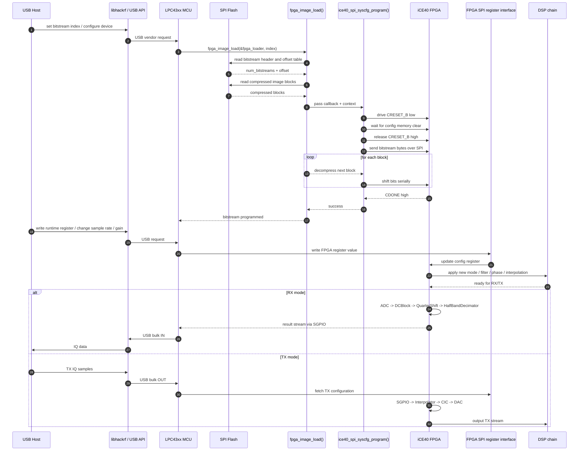

# HackRF MCU → FPGA Bitstream Load 与 Runtime Register Control

本文档根据项目中的 MCU 固件代码和 FPGA gateware 代码，整理出一条完整的控制链：

- MCU 如何在启动时把 FPGA bitstream 下载进去
- FPGA 如何在运行时接收来自 MCU 的寄存器配置
- MCU/host 如何在运行中控制 FPGA 的 RX/TX 参数

## 1. 总体结论

HackRF 的 FPGA 并不像普通开发板那样“裸金属程序直接跑在 CPU 上”，而是采用了典型的“配置 + 控制”的分层方式：

1. MCU 从 SPI flash / 固件镜像中读取 FPGA bitstream
2. MCU 通过 SPI/JTAG 接口把该 bitstream 下载到 FPGA 配置接口
3. FPGA 成功配置后，进入运行状态
4. MCU 再通过 FPGA 寄存器接口（SPI / SGPIO / config bus）写入运行参数
5. FPGA 的 DSP 链据此工作，例如 decimation、interpolation、trigger、NCO 等

因此，MCU 对 FPGA 的控制不等于“读取 RAM 内存然后执行代码”，而是：

- 配置实例化硬件逻辑（bitstream）
- 控制已实例化逻辑的参数（registers）

## 2. 代码入口：MCU 启动时加载 FPGA

关键代码：

- `firmware/hackrf_usb/hackrf_usb.c`
- `firmware/common/fpga_image.c`
- `firmware/common/ice40_spi.c`

### 2.1 启动时调用位置

`firmware/hackrf_usb/hackrf_usb.c` 中的 `main(void)` 会在启动时执行：

```c
#ifdef IS_PRALINE
if (IS_PRALINE) {
#if defined(DFU_MODE) || defined(RAM_MODE)
    selftest.fpga_image_load = SKIPPED;
    selftest.report.pass = false;
#else
    fpga_image_load(&fpga_loader, 0);
#endif
    delay_us(100);
    fpga_spi_selftest();
    fpga_sgpio_selftest();
}
#endif
```

这里说明：

- 在 HackRF Pro（Praline）平台上，MCU 会在启动时自动加载 FPGA bitstream
- 这一步不是 host 侧在之后再干的，而是固件启动流程的一部分

### 2.2 载入逻辑：读取 bitstream + 解压 + 配置 FPGA

`firmware/common/fpga_image.c` 中 `fpga_image_load()`：

```c
bool fpga_image_load(struct fpga_loader_t* loader, unsigned int index)
{
    if (loader->setup != NULL)
        loader->setup();

    uint32_t addr = loader->start_addr;
    uint32_t num_bitstreams, bitstream_offset;
    loader->read(addr, 4, (uint8_t*) &num_bitstreams);
    if (index >= num_bitstreams)
        return false;
    loader->read(addr + 4 * (index + 1), 4, (uint8_t*) &bitstream_offset);

    ice40_spi_target_init(&ice40);
    struct fpga_image_read_ctx fpga_image_ctx = {
        .loader = loader,
        .addr = loader->start_addr + bitstream_offset,
    };
    const bool success = ice40_spi_syscfg_program(
        &ice40,
        loader->out_buffer,
        fpga_image_read_block_cb,
        &fpga_image_ctx);

    selftest.fpga_image_load = success ? PASSED : FAILED;
    return success;
}
```

它的职责：

- 读取图片索引和偏移表
- 从 flash 中按 bitstream 索引定位对应镜像
- 通过回调函数逐块读取 bitstream
- 把数据交给 iCE40 编程器

## 3. FPGA bitstream 的真正下载：SPI 编程接口

关键文件：

- `firmware/common/ice40_spi.c`

最关键函数：

```c
bool ice40_spi_syscfg_program(
    ice40_spi_driver_t* const drv,
    uint8_t* buf,
    size_t (*read_block_cb)(void* ctx),
    void* read_ctx)
```

这个函数的结构很典型：

```c
spi_bus_start(drv->bus, &ssp_config_ice40_fpga);

gpio_clear(drv->gpio_creset);
gpio_clear(drv->gpio_select);
delay_us(1);
gpio_set(drv->gpio_creset);
delay_us(1800);

gpio_set(drv->gpio_select);
spi_ssp1_transfer_word(0);

gpio_clear(drv->gpio_select);
for (;;) {
    size_t read_sz = read_block_cb(read_ctx);
    if (read_sz == 0)
        break;
    for (size_t j = 0; j < read_sz; j++) {
        spi_ssp1_transfer_word(buf[j]);
    }
}

gpio_set(drv->gpio_select);
for (size_t j = 0; j < 13; j++) {
    spi_ssp1_transfer_word(0);
}

return gpio_read(drv->gpio_cdone);
```

它做了这些事情：

- 拉低 `CRESET_B`，使 FPGA 进入配置模式
- 按 iCE40 要求等待清除内部配置存储器
- 释放 `CRESET_B`，让 FPGA 准备接收配置
- 通过 SSP1/SPI 逐字节串行发送 bitstream
- 等待 `CDONE` 拉高，表示配置成功

这说明：

- MCU 不是“把代码写入 FPGA 的 RAM”
- 而是“将硬件描述的 bitstream 通过 SPI 编程接口灌进 FPGA 配置存储器”

## 4. 老平台的 CPLD 下载：JTAG 方式

老的 HackRF 平台并没有 FPGA，而是 CPLD。其配置方式不同：

- `firmware/common/cpld_jtag.c`
- `firmware/hackrf_usb/usb_api_cpld.c`

其中关键函数：

```c
bool cpld_jtag_sram_load(jtag_t* const jtag)
{
    cpld_jtag_take(jtag);
    cpld_xc2c64a_jtag_sram_write(jtag, &cpld_hackrf_program_sram);
    const bool success = cpld_xc2c64a_jtag_sram_verify(
        jtag,
        &cpld_hackrf_program_sram,
        &cpld_hackrf_verify);
    cpld_jtag_release(jtag);
    return success;
}
```

这说明：

- MCU 通过 JTAG GPIO 发送 CPLD bitstream
- 让 CPLD 进入编程状态
- 然后校验 SRAM 内容

也就是说，CPLD 是“JTAG 配置”，而 FPGA 是“SPI 配置”。

## 5. 配置完成后，如何控制 FPGA 运行

配置成功后，FPGA 不是立刻全开跑，而是需要通过寄存器控制它的行为。

### 5.1 FPGA 寄存器接口

 FPGA 侧的关键代码：

- `firmware/fpga/interface/spi.py`
- `firmware/fpga/top/standard.py`

在 `standard.py` 中，会通过 SPI register interface 定义一组寄存器，例如：

```python
spi_regs.add_register(0x01, init=0)
spi_regs.add_register(0x02, init=0, size=3)
spi_regs.add_register(0x03, init=0)
spi_regs.add_register(0x04, init=0, size=1)
spi_regs.add_register(0x05, init=0, size=3)
spi_regs.add_register(0x06, init=0)
```

这些寄存器控制：

- RX DC block
- quarter-shift
- decimation ratio
- TX interpolation ratio
- NCO enable / phase step
- trigger enable / PRBS

也就是说，FPGA 的“运行状态”是寄存器驱动的，而不是“写死在 bitstream 里不能改”。

### 5.2 MCU 与 FPGA 寄存器的交互

MCU 侧有专门的 USB API：

- `firmware/hackrf_usb/usb_api_praline.c`
- `firmware/hackrf_usb/usb_api_register.c`

例如：

```c
usb_vendor_request_set_fpga_bitstream(...)
usb_vendor_request_write_fpga_reg(...)
usb_vendor_request_read_fpga_reg(...)
```

这些请求最终会调用寄存器访问逻辑，把参数写到 FPGA。

从代码语义上看：

- host 发送控制命令
- MCU 解析后调用寄存器函数
- FPGA 的 SPI register interface 读取/写入命令
- FPGA DSP chain 按新参数调整运行行为

## 6. 详细时序图：MCU -> FPGA bitstream load -> runtime register control



## 7. 关键理解：MCU 不是直接 “对 FPGA 运行内存”

这点非常重要：

- 配置阶段：MCU 把 bitstream 加载进 FPGA，类似“烧录硬件描述”
- 运行阶段：MCU 通过寄存器和控制线对 FPGA 参数进行动态更新
- 数据阶段：真正的数据 I/O 由 SGPIO / ADC / DAC 以及 FPGA DSP 链完成

因此，HackRF 项目中的 MCU/FPGA 架构更像：

- MCU = 控制器 + 接口协调器
- FPGA = 可重配置的 DSP 硬件加速器

## 8. 代码对应关系速查

- 启动加载 FPGA：`firmware/hackrf_usb/hackrf_usb.c`
- bitstream 读取与解压：`firmware/common/fpga_image.c`
- FPGA SPI 配置：`firmware/common/ice40_spi.c`
- CPLD JTAG 配置：`firmware/common/cpld_jtag.c`
- host 到 MCU 请求：`firmware/hackrf_usb/usb_api_praline.c`
- MCU 到 FPGA 寄存器：`firmware/hackrf_usb/usb_api_register.c`
- FPGA register interface：`firmware/fpga/interface/spi.py`
- FPGA 运行入口：`firmware/fpga/top/standard.py`

## 9. 一句话总结

HackRF 中 MCU 对 FPGA 的控制方式，本质上是：

- 先用 bitstream 把 FPGA “烧成”指定硬件逻辑
- 再通过寄存器和 SGPIO 让该逻辑运行在所需模式下

也就是“配置硬件” + “调参运行”，而不是“把 RAM 映像直接执行在 FPGA 上”。
